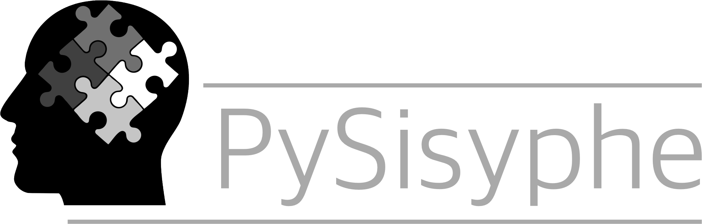

Overview
========

**PySisyphe** is a general purpose neuroimaging visualization and post-processing software.
Versions for MS Windows, MacOS and Linux (Ubuntu 26.04 LTS) platforms are available.

It supports advanced 2D and 3D visualization modes and a comprehensive collection of post-processing functions: filtering, texture analysis, co-registration, segmentation, fMRI analysis, time series analysis, perfusion and diffusion/tractography processing.

Visualization functions are based on the [VTK](https://docs.vtk.org/en/latest/) library. Reference libraries provide post-processing: [ITK](https://itk.org/), [SimpleITK](https://simpleitk.org/) (filtering, Region-Of-Interest tools), [pyradiomics](https://pyradiomics.readthedocs.io/en/latest/) (texture analysis), [ANTspyx](https://github.com/ANTsX/ANTsPy) (co-registration, prior-based registration, cortical thickness), [ANTspynet](https://github.com/antsx/antspy) (deep learning segmentation), [nilearn](https://nilearn.github.io/stable/index.html) (time-series analysis), [dipy](https://dipy.org/index.html) (diffusion/tracking analysis).

Five viewing widgets are integrated:

- **Slice view**: grid of adjacent slices with axial, coronal or sagittal orientation.
- **Orthogonal view**: three synchronized orthogonal slices and a 3D surface/texture renderer.
- **Synchronized view**: grid of slices from multiple synchronized volumes.
- **Projection view**: grid of fixed (non-interactive) 3D projections in left, right, mid-left, mid-right, cranial, caudal, anterior and posterior orientations.
- **Multi-component view**: grid of slices from adjacent volumes of a time series multi-component volume.

Common tools of viewing widgets: look-up table management, overlay(s) management, isovalue display, ROI display, mesh display, target/trajectory tools, measurement tools (distance, orthogonal distances, angle), screenshots.

ROI tools: various 2D/3D brushes, cut/copy/paste, flip, translations in any direction, interpolating empty slices, automatic or interactive hole filling, mathematical morphology operators, set operators (union/intersection/difference/symmetric difference), thresholding, region-growing segmentation, confidence connected segmentation, active contour (snake) segmentation, Med-SAM segmentation (Meta AI). Most of these tools can be applied to 2D slices, whole 3D volume or to blob(s) derived from connected component labeling. Any ROI processing can be cancelled with unlimited number of undo/redo.

The interface also includes a patient database manager, a file manager, a screenshots manager and a fully functional IPython console.

List of available post-processings:

- Flip/reorientation
- Datatype conversion
- Image attributes conversion
- Voxel-by-voxel algebra (mean, median, std, min, max, any numpy expression)
- Automatic removal of caudal slices (neck slices, usually as part of a 3D sagittal acquisition)
- Filtering/denoising: median, mean, gaussian, anistropic diffusion, non-local means, gradient magnitude, laplacian
- Intensity matching between volumes: histogram matching, regression matching
- Intensity normalization (0-1, z-score...)
- Texture analysis (first order, 2D and 3D Shape-based, gray level co-occurrence matrix, gray level run length matrix, gray level size zone matrix, neighbouring gray tone difference matrix, gray level dependence matrix)
- Biais field correction
- Fiducial markers detection of Leksell stereotaxic frame
- Co-registration (manual, frame-based, rigid, affine, displacement field, ICBM spatial normalization, batch)
- Time series realignment
- Eddy current correction
- Asymmetry analysis
- Resampling
- KMeans segmentation
- Prior-based tissue segmentation (gray matter, white matter, cerebro-spinal fluid)
- Registration-based segmentation
- Cortical thickness map
- Deep learning segmentation (skull striping, GM/WM/LCS tissue segmentation, JHU atlas parcellation, hippocampus, medial temporal lobe, focal cortical dysplasia, glioma, meningioma, metastasis, microbleeds, T1 hypo-intensity lesions, white matter hyper-intensities)
- fMRI analysis (model, contrast, conjunction...)
- Time series analysis (ICA)
- Quantitative MR: B0 map, B1 map, T1 map, T2/T2* map, T2' map, MTR map, QSM map
- ASL DSC map
- Dynamic susceptibility contrast MR perfusion maps
- Diffusion/tracking visualization and analysis tools (DTI, FWDTI, DKI, IVIM, RUMBA, SHCSA, SHCSD, DSI, DSID models)
- Batch processing
  
The most common neuroimaging formats are imported/exported: DICOM (including RTSTRUCT and RTDOSE), Nifti, Nrrd, Minc, Brainvoyager, FreeSurfer, Vtk, Numpy.

All native PySisyphe files are in XML format (.xvol volume, .xroi ROI, .xmesh mesh, .xtracts tracking streamlines, .xtrf/.xtrfs geometric transformation, .xlut look-up table...).

A large collection of atlases and templates (volumes, ROI, meshes, streamlines) is already included in the package: sym and asym ICBM152, ICBM452, Atropos, Distal, Nac, SPL, SRI24.

PySisyphe is plug-in extensible and provides a fully documented API that gives access to all of the software's advanced features and widgets for fast plug-in development. API classes are available in the PySisyphe's IPython console.

[PySisyphe Website documentation](https://pysisyphe.github.io/Sisyphe/home.html)

[PySisyphe NITRC website](https://www.nitrc.org/projects/pysisyphe/)

Download PySisyphe
==================

[Download source](https://mega.nz/folder/G18X2IRQ#BRpA7_fcyHBIK66aZNyntA)

[Download folder](https://mega.nz/folder/Kt8hzbSa#AUkLH1WH0zoawYolT8Ep0w)

Direct link to binary archives:
- Windows x64 binary, python 3.12 [PySisyphe 1.12.07 python 3.12 build 20-11-2026](https://mega.nz/file/HlVlhKaY#fPGR-YvsM806IhCVbi5pSJHLxgEZo92hv5_tsCmp6mI)
- MacOS 11+ x64 binary, python 3.12 [PySisyphe 1.12.07 python 3.12 build 20-11-2026](https://mega.nz/file/S5MnGTaS#AZOZYlP-5ifOhUU-4YOn_zjp2yADeo5skiToqm6gGWM)
- Linux Ubuntu 26.04 LTS x64 binary, python 3.12 [PySisyphe 1.12.07 python 3.12 build 20-11-2026](https://mega.nz/file/qptSxThR#CLamVzV4vFnDx5eI-orxT3nhiQL4z3-e4e9t2jhrubE)

Unzip the downloaded archive into the directory of your choice. The PySisyphe folder can be placed anywhere; it does not have to be in the Program Files directory on Windows or the Applications directory on MacOS. **We recommend copying it to the user directory**. To launch the software, double-click on PySisyphe.exe on Windows or PySisyphe.app on MacOS. PySisyphe may take more than a minute to start up when running for the first time. Subsequent starts take less than 30 seconds.

On the Linux Ubuntu platform, install the X11 xcb library from the terminal:

	sudo apt install libxcb-cursor0 libxcb-icccm4 libxcb-image0 libxcb-keysyms1 libxcb-render-util0 libxcb-xinerama0 libxcb-xinput0 libxcb-randr0 libxcb-shape0 libxcb-xfixes0 libxkbcommon-x11-0

Unzip the PySisyphe archive from the terminal:

	cd ~
	unzip PySisyphe_release_cp312_x-xx-xx_xx-xx-20xx_linux_ubuntu_LTS26-04_x64.zip

Launch PySisyphe from the terminal:

	cd ~/PySisyphe
	./PySisyphe

Launch PySisyphe from the Nautilus file manager:

	- double-click on PySisyphe executable in the ~/PySisyphe folder, or
	- right-click on the PySisyphe executable, and select "Run" from the popup menu.

**PySisyphe may trigger false alerts from antivirus software, particularly on the Windows platform (e.g., Avast One). If this happens, be sure to add PySisyphe.exe to the list of trusted software.**

On the Windows 11 platform, the terminal (i.e. console) remains visible in the taskbar. If you would prefer it to be hidden, simply change the default terminal application.

	- click the Start button,
	- open Windows Terminal application,
	- click the dropdown arrow (▾) in the tab bar,
	- select Settings,
	- under Startup, locate Default terminal application,
	- set it to Windows Console Host,
	- save changes.

The PySisyphe graphical user interface has been optimized for dark mode, so we recommend using this mode for the best user experience.

Enabling dark mode on the Windows 11 platform:

	- click the Start button,
	- select Settings (or press Windows + I),
	- click Personalization in the left menu,
	- select Colors,
	- in the Choose your mode line, select the Dark option to enable Windows 11 dark mode.

Enabling dark mode on the MacOS platform:

	- click the Apple menu in the top-left corner of your screen,
	- select System Settings,
	- click Appearance in the sidebar,
	- choose Dark.

Enabling dark mode on the Linux Ubuntu 26.04 platform:

	- click on the System Tray in the upper right corner and click the gear wheel icon to open settings,
	- in the dialog box that opens, in the left side pane, scroll down and click on Appearance,
	- in the center pane, in the Style section, click on Dark.

Additional content, such as templates, atlases, samples, plugins, and various modality scans from healthy volunteer groups, can be retrieved directly from the download manager integrated into the PySisyphe interface. To access the download manager, select **File > Download Manager**.

Download atlases converted to PySisyphe format (*.xvol)
=======================================================

- [AheadBrain](https://mega.nz/file/JWcSXAiS#jIJAgB5PoFxCcOyJX64jkCl-yNoAybiJmstQvjYsflE), [website](https://brain.labsolver.org/histology.html)
- [Allen](https://mega.nz/file/Qbt2WKCZ#zEdXRzCvPPANAh6lGMIQl_drjc60D_Fw-qy3lAGT_qw), [website](https://community.brain-map.org/t/allen-human-reference-atlas-3d-2020-new/405)
- [Arterial](https://mega.nz/file/4DEEmSiJ#fpVuCqB8AKFyU6JHIm7g1f6720nCyC0RcMS9JcUWotk), [website](https://www.nitrc.org/projects/arterialatlas/)
- [Atag](https://mega.nz/file/NDNSGJyB#t_IoSE5BXuxEB-n9adrJUNub0GST8Hi23UzhVprR3NQ), [website](https://www.nitrc.org/projects/atag)
- [Atropos](https://mega.nz/file/5K9jlbbA#VSReS_wpvadeAakS_yq2TuYEzjL7YFfUZJSKhQCK73U), [website](https://mindboggle.info/data.html)
- [BigBrain](https://mega.nz/file/pKVwGSKb#dQ_9PdA80Y_20GyvSzuiWTDJUxUvooJ1_RcadRob93w), [website](https://brain.labsolver.org/histology.html)
- [Brainnav](https://mega.nz/file/9PkhGKYK#84lJ6gyggNF0VaSNViPNEXRuoVPXTQ0iLGgo3j7KOr8), [website](https://www.nitrc.org/projects/brainstemnavig)
- [BRAVISSIMA](https://mega.nz/file/JXthnDRR#0FsISGYigtlrYVwTWt52iqDJom9ic3EqalhUviku8EU), [website](https://www.nitrc.org/projects/bravissima/)
- [Bundles HCP](https://mega.nz/file/1XtAwK6b#iv7yWIzVNTms8kx0gbQoUdUMnp42TqBBRrvyTKYzsPE), [website](https://brain.labsolver.org/hcp_template.html)
- [Bundles IIT](https://mega.nz/file/FfdhVaJD#7cjAmkP7ezlUeGGn7wfZK23HkgpHqWjmG72PN2jwJIM), [website](https://www.nitrc.org/projects/iit/)
- [Bundles LC2TEC](https://mega.nz/file/UGVGEbiQ#znSq33Lw5ZaxRQTcszwNAGC_vYa-UTb0E80ltmgDLRw), [website](https://www.nitrc.org/projects/brainstem_atlas/)
- [CMB](https://mega.nz/file/laMAUYoY#FKNqkN1MJLBik0wLDKAc65oNiBhYsYE-KbUG-gJSZzo), [website](https://zenodo.org/records/20553851)
- [Colin27](https://mega.nz/file/8SdFFA7S#r6dDa3_LE9TDFWlRciJnoAtKAzulK2bOOGQQ0_LlQSU), [website](https://meca-brain.org/software/marsatlas-colin27/)
- [Dartel](https://mega.nz/file/hK1xRQqI#VxSXaJVANoRNyXGual7jznujgrmF8j8R08kFHAVuH3o)
- [Desikan](https://mega.nz/file/wGtjkYpL#i7oVF7kyZlMjajPGXgjlqmCHMIevrjd-TomqVI0lbmU), [website](https://www.sciencedirect.com/science/article/abs/pii/S1053811906000437?via%3Dihub)
- [Destrieux](https://mega.nz/file/BaVmyBSA#3gacV_U6P1uyes0M4hJUXeViPcR4ETAu_U3Bdq9qBwc), [website](https://www.sciencedirect.com/science/article/abs/pii/S1053811910008542?via%3Dihub)
- [Distal](https://mega.nz/file/oLNxkZIQ#zkVz-TnX6k15yMn5ZlxF-L9eqapkUBBUuFLelbgT2Qw), [website](https://www.lead-dbs.org/helpsupport/knowledge-base/atlasesresources/atlases-2/)
- [GOBS](https://mega.nz/file/wPEFlSbL#f91Mw7Fg1_G7hd6l5S3iiQnNa3akiypzcqFRjPh-gDs), [website](https://brainder.org/download/flair/)
- [HoliAtlas](https://mega.nz/file/xL10zSrS#XLGmI6xgwQq2rsZEuWCrrzijbaV-6E1PB7poVJwu7M4), [website](https://arxiv.org/html/2501.16879v1)
- [ICBM152 HR](https://mega.nz/file/NK0UnZbY#vExN9F-ljmqsimXSOmmAuH1LlX2ssucvLs_L8r-pOZ0), [website](https://www.bic.mni.mcgill.ca/ServicesAtlases/ICBM152NLin2009)
- [ICBM152 Subcortical](https://mega.nz/file/wOdUmRbY#jeRzvtB6TVLYDoWFm9WXOv2qyVOObFObFEf-zac46_c) 
- [ICBM452](https://mega.nz/file/UfthWJSa#iYcsQ0H3_idkKaagUmHcnF7Vts-nlvdaUFg4j_sYTUo), [website](https://www.loni.usc.edu/research/atlas_downloads)
- [LPBA40](https://mega.nz/file/0DkGVK4A#ltwyzRWJK0l_jWQU6ZHhvWavsRwe2kUqjgMTKihMV5E), [website](https://www.loni.usc.edu/research/atlas_downloads)
- [NAC](https://mega.nz/file/5DUDgKrB#YxddiOZbHoGPwDJttR64G4pRySv9iOqElxuIj2z4ouM), [website](https://www.openanatomy.org/atlas-pages/atlas-spl-nac-brain.html)
- [PD25](https://mega.nz/file/kWcEibKJ#fHQ338E2TVadtougl1ub74XWikDg3iyelrs-vAd8Ork),[website](https://nist.mni.mcgill.ca/multi-contrast-pd25-atlas/)
- [SPL](https://mega.nz/file/lHVAHTRK#Uhh3ayGn0fmOtzCV1GauP1dIVW0mb4oQbGH7AXhdRvo), [website](https://www.openanatomy.org/atlas-pages/atlas-spl-nac-brain.html)
- [SRI24](https://mega.nz/file/lGlXFSwQ#kM3ownKbVlDYlYynM82z2BcNkMCZcuVVRRlskhz5c4A), [website](https://www.nitrc.org/projects/sri24)
- [THOMAS](https://mega.nz/file/ASk3UDgY#3ce2sycSUz20HYmpDiIZxHfF4WagDVdB1Zw3ikxif8s), [website](https://github.com/thalamicseg/hipsthomasdocker)
- [VisibleHumanProject](https://mega.nz/file/Ie90iKCT#7jq3po9UUE26KGKTOjHVrLDmu5cdDCQt3ShgB733o6Y), [website](https://datadiscovery.nlm.nih.gov/Diagnostic-Imaging/Visible-Human-Project/ux2j-9i9a/about_data)

Download healthy volunteer groups converted to PySisyphe format (*.xvol)
========================================================================
	
- MR T1 [SRPBS](https://dri.me/ynG4FVU3oxHuWBx1zIbafRlrkU1Rs6) (1410 healthy volunteers, [website](https://bicr-resource.atr.jp/srpbsopen/))
- MR T1 [IXI](https://mega.nz/file/joN1FbSD#YNhxg09qCBXPUKWo1jKKvz-M32WoEXWX_4AGoSRJUkk) (582 healthy volunteers, [website](https://brain-development.org/ixi-dataset/))
- [FDG PET](https://mega.nz/file/we81CDQY#WCmatVKZMzmvS_4NtDeNLUmRcrEMwiHeowTAVD1JJ-Y) (116 healthy volunteers, [website](https://www.nitrc.org/projects/cnpet))
- [PIB PET](https://dri.me/7V0ZGfBp3jgbItZF6f4f2xHFbejKgh) (34 healthy volunteers, [website](https://gaain.org/centiloid-project))
- [HMPAO SPECT](https://mega.nz/file/QfM2VSQK#yUGi10cXwJTqeFwADmxPBASRjb7mUpZhqM7TLkO_Zkc) (32 healthy volunteers)
